# FlexaScale — Results

This folder holds the project's strongest **genuine** results, selected from 289 recorded live runs, two pre-registered
evaluations and a dedicated end-to-end verification. Every number is traceable: the selected runs' raw data stay in
`reports/experiments/<run id>/`, the pooled statistics come from the pre-registered analyses
(`reports/v9/evaluation.json`, `reports/v7/replication.json`), and `scripts/build_results.py` regenerates every data
file and chart here from those sources. Nothing was typed in by hand or estimated.

| Folder / file | Content |
|---|---|
| `RESULTS.md` | This report |
| `data/selected_runs.csv`, `.json` | One row per selected run: configuration and every metric (p50/p90/p95/p99, errors, CPU, memory, replicas, replica-hours, cost, SLA) |
| `data/comparisons.csv`, `.json` | Pre-registered pooled comparisons: mean Δ and 95% CI per metric, verdict |
| `data/v9_auto_vs_default_pairs.csv` | Every paired difference behind the v9 Auto vs default-HPA comparison |
| `charts/*.svg` | The charts used below |
| `screenshots/*.png` | The dashboard showing these runs (taken from the running control center) |
| `verification/README.md`, `verification/*.json` | End-to-end verification of the three controller modes on the live cluster (Auto selecting FlexaScale and HPA, fallbacks) |

Rebuild: `python scripts/build_results.py` (data and charts), `python scripts/verify_controller_modes.py --report`
(verification report from its saved runs).

---

## 1. Project result overview

1. **The complete system works end to end on a real Kubernetes cluster.** Metrics → discovery → features → call graph →
   GNN → PPO → Auto arbitration → safety guards → Lease + HPA freeze → Kubernetes scaling → new metrics → dashboard was
   exercised live for all three controller modes, including the failure paths (Section 9 and `verification/`).
2. **Against default native HPA, FlexaScale and Auto use fewer resources.** In the pre-registered v9 evaluation
   (11 pairs each), replica-hours were **−7.3%** (RL) and **−7.7%** (Auto), both with 95% intervals entirely below zero,
   and estimated cost −7.4% / −7.9%. The largest single saving is the **flash sale**: Auto −22.9% replica-hours with
   p95 −51.2% (E1), RL −20.1% with p95 −64.5% (E2).
3. **But the pre-registered verdict against default HPA is "on par / inconclusive"**, because the latency checks were not
   met: across all scenarios p95 was +17.6% (Auto) and +53.5% (RL) on average, with wide intervals.
4. **Against a fairly tuned native HPA, FlexaScale is on par.** v9 (second laptop): replica-hours +0.3% (RL) and +0.2%
   (Auto); v7 replication (first laptop): +0.1% / +0.1%, Auto p95 +0.1% [−9.3 … +9.5]. A tuned HPA achieves the same saving
   over default HPA without any model (−9.0% [−13.9 … −4.1]).

In one sentence: **FlexaScale is a working, safe, explainable RL autoscaler that saves resources compared with default
HPA, mostly during spikes, and matches but does not beat a carefully tuned HPA.**

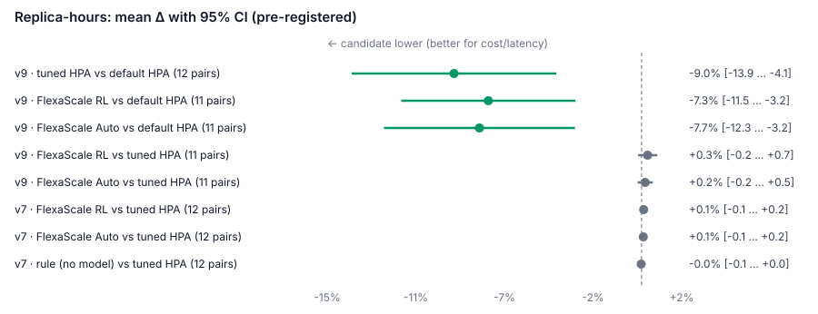

---

## 2. Best FlexaScale experiments

Selection rule: valid runs of the pre-registered v9 evaluation (complete load window, settled start from 1 replica per
service, cleanup verified, host-load check passed; `reports/v9/host_load_evaluation.csv`) where a FlexaScale arm is
better than default HPA on a clearly defined metric. All four arms of a block ran back to back, same scenario and
settings, in an order fixed by seed before the first run (`docs/POLICY_V9.md` §6).

| Id | Experiment | Why it is selected |
|---|---|---|
| **E1** | v9 block 4 — flash sale — **Auto** vs default and tuned HPA | Best single result: fewer replicas **and** lower latency than default HPA |
| **E2** | v9 block 10 — flash sale — **FlexaScale RL** vs default and tuned HPA | Same scenario, the pure learned policy (no Auto rules): replicates E1's direction |
| **E3** | v9 block 2 — checkout heavy — Auto and RL vs default and tuned HPA | Second-largest saving vs default HPA, with an honest latency cost |
| **E4** | v9 block 8 — checkout heavy (repeat) | Independent repeat of E3: same direction |

**Common configuration (all four).** Second laptop (Windows 11, Minikube 4 vCPU / 6 GB), 16-service shop (Helm chart
1.1.0), Locust, **25 peak users**, spawn 5/s, **300 s**, initial replicas **1 for every service**, HPA bounds 1–10.

* *Default HPA:* CPU target 70% of request, 300 s scale-down window (Kubernetes default).
* *Tuned HPA:* CPU target 350% of request, 60 s scale-down window (calibrated by a rule fixed in advance,
  `reports/v9/calibration.md`).
* *FlexaScale RL:* model `models/flexascale_v9/best_model/best_model.zip` (GNN + PPO, 2 message-passing rounds, actions
  −1…+3), live; guards: max step +3/−1, replica budget 48, cooldowns 20 s up / 30 s down, scale-down blocked at CPU
  ≥ 400% of request.
* *Auto:* the same model and guards plus the Auto rules (CPU risk 400%, HPA recommendation at 350%, dwell 2 steps); a
  service handed back to HPA is scaled by the **tuned** HPA settings in this study (the pre-registered "v9 or HPA-tuned"
  arm).
* *Cost:* allocated vCPU-h × $0.04048 + GiB-h × $0.004445 (AWS Fargate list prices, an estimate, not a bill).
* *SLA:* end-to-end p95 ≤ 1000 ms per ~10 s Locust window; "SLA violation" = seconds of violated windows.

---

## 3. Scenario-by-scenario explanation

### E1 — Flash sale, Auto vs HPA (v9 block 4)

Workload: 5 users (20% of peak) for 75 s, a sudden jump to 25 users with checkout contention until 195 s, then back to
5 users.

| Metric | Default HPA | Tuned HPA | **FlexaScale Auto** | Auto vs default |
|---|---:|---:|---:|---:|
| Run | `20261029-173816-…-hpa-flash_sale` | `…-170301-…-hpa_tuned-…` | `20261029-171432-…-auto-flash_sale` | |
| Throughput (req/s) | 15.62 | 16.15 | **16.95** | +8.5% |
| p50 / p90 (ms) | 130 / 240 | 120 / 270 | 130 / 180 | p90 −25% |
| **p95 (ms)** | 410 | 320 | **200** | **−51.2%** |
| p99 (ms) | 1300 | 470 | 340 | −74% |
| Error rate (%) | 0.30 | 0.43 | 0.35 | +0.06 pp |
| Avg CPU (% of request) / memory (%) | 24.3 / 25.5 | 33.8 / 26.3 | 33.5 / 26.3 | higher utilisation |
| Avg / peak replicas | 22.2 / 27 | 16.3 / 17 | 16.6 / 17 | −25% / −10 |
| **Replica-hours** | 1.829 | 1.386 | **1.410** | **−22.9%** |
| Estimated cost (USD) | 0.00831 | 0.00628 | 0.00639 | −23% |
| SLA violation (s) | 30 | 0 | **0** | −30 s |
| Scaling events | 8 | 2 | 2 | −6 |
| SLA status (whole-run p95 ≤ 1000 ms) | met | met | met | |

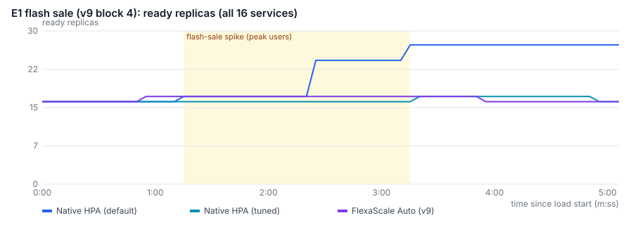
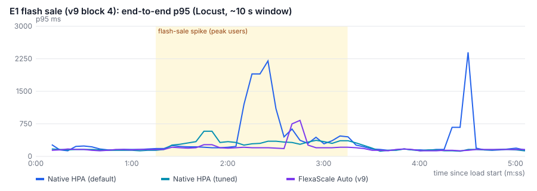

**Why it is interesting.** Default HPA reacted to the spike by adding replicas *late* (after the peak had started) and
kept them for 5 minutes after it ended, reaching 27 replicas; it still violated the SLO for 30 s. Auto, with the v9
policy owning the services, added a single replica where it mattered and held the rest; there was no SLO violation,
and p95 halved.

**Limitations.** One pair (block 4's RL arm was host-affected and is in block 10 instead). Tuned HPA in the same block
achieved almost the same (1.386 replica-hours, p95 320 ms): the saving comes mainly from *not* over-scaling, which a
higher HPA target also achieves. At 25 users the shop is lightly loaded; the result shows FlexaScale avoids waste, not
that it handles a heavier spike better.

### E2 — Flash sale, FlexaScale RL vs HPA (v9 block 10)

| Metric | Default HPA | Tuned HPA | **FlexaScale RL** | RL vs default |
|---|---:|---:|---:|---:|
| Run | `20261029-232612-…-hpa-flash_sale` | `…-231441-…-hpa_tuned-…` | `20261029-225719-…-flexascale-flash_sale` | |
| Throughput (req/s) | 13.36 | 15.24 | **15.12** | +13% |
| p50 / p90 (ms) | 140 / 530 | 130 / 330 | 130 / 270 | p90 −49% |
| **p95 (ms)** | 930 | 400 | **330** | **−64.5%** |
| p99 (ms) | 3200 | 760 | 1400 | −56% |
| Error rate (%) | 0.92 | 0.37 | 0.37 | −0.55 pp |
| Avg CPU / memory (%) | 27.7 / 25.0 | 32.6 / 25.7 | 32.4 / 25.6 | |
| Avg / peak replicas | 21.4 / 28 | 16.5 / 17 | 16.6 / 17 | |
| **Replica-hours** | 1.766 | 1.398 | **1.412** | **−20.1%** |
| Estimated cost (USD) | 0.00802 | 0.00633 | 0.00639 | −20% |
| SLA violation (s) | 115 | 5 | 30.1 | −85 s |
| Scaling events | 10 | 1 | 2 | |

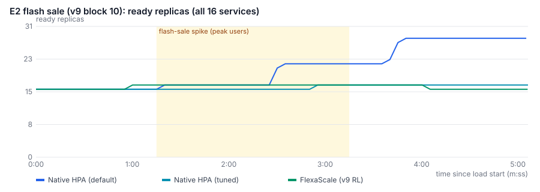
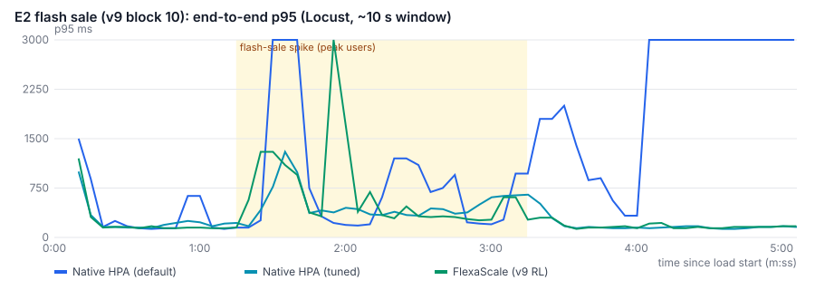

**Why it is interesting.** The pure learned policy (no Auto rules) reproduces E1's pattern in an independent block:
about 20% fewer replica-hours and much better latency than default HPA during a spike.

**Limitations.** One pair. Tuned HPA again matches the replica-hours and has less SLA-violation time (5 s vs 30 s) and a
lower p99 (760 vs 1400 ms): **FlexaScale wins against default HPA, not against tuned HPA.**

### E3 / E4 — Checkout heavy (v9 blocks 2 and 8)

Mostly authenticated cart and checkout journeys at a constant 25 users.

| Metric | Default HPA (E3 / E4) | Tuned HPA (E3 / E4) | FlexaScale RL (E3 / E4) | **Auto (E3 / E4)** |
|---|---:|---:|---:|---:|
| Throughput (req/s) | 21.42 / 20.89 | 21.47 / 21.14 | 21.39 / 20.80 | 21.06 / 20.61 |
| p50 / p90 (ms) | 37 / 140 · 46 / 160 | 38 / 140 · 45 / 150 | 38 / 150 · 46 / 170 | 39 / 150 · 48 / 170 |
| p95 (ms) | 160 / 180 | 160 / 170 | 170 / 190 | 170 / 190 |
| p99 (ms) | 200 / 670 | 200 / 250 | 210 / 1000 | 210 / 520 |
| Error rate (%) | 0.61 / 0.70 | 0.71 / 0.95 | 0.67 / 0.72 | 0.74 / 0.85 |
| Avg / peak replicas | 19.1 / 20 · 18.7 / 20 | 16.0 / 16 · 16.0 / 16 | 16.0 / 16 · 16.0 / 16 | 16.0 / 16 · 16.0 / 16 |
| **Replica-hours** | 1.605 / 1.578 | 1.360 / 1.360 | 1.360 / 1.360 | **1.360 / 1.360** |
| Replica-hours vs default | | | −15.3% / −13.8% | **−15.3% / −13.8%** |
| Estimated cost (USD) | 0.00728 / 0.00716 | 0.00615 / 0.00615 | 0.00615 / 0.00616 | 0.00615 / 0.00616 |
| SLA violation (s) | 10 / 20 | 10 / 10 | 10 / 40.1 | 10 / 15 |

**Why it is interesting.** Both repeats agree: default HPA scaled three or four services to 2 replicas for a CPU
signal that did not need it, while FlexaScale (RL and Auto) correctly held every service at 1 replica, saving 14–15%.

**Limitations — FlexaScale wins on cost but loses slightly on latency.** p95 was +6% (170 vs 160 ms, 190 vs 180 ms), at
the resolution of Locust's percentile buckets, and RL's p99 in E4 was 1000 ms. Tuned HPA did exactly the same as
FlexaScale (1.360 replica-hours) with equal or lower latency.

---

## 4. HPA comparisons (pooled, pre-registered)

| Study | Comparison | Pairs | Replica-hours Δ [95% CI] | p95 Δ [95% CI] | Verdict |
|---|---|---:|---|---|---|
| v9 | tuned HPA vs default HPA | 12 | **−9.0% [−13.9 … −4.1]** | −10.7% [−27.5 … +6.1] | Beats on cost |
| v9 | FlexaScale RL vs default HPA | 11 | **−7.3% [−11.5 … −3.2]** | +53.5% [−49.4 … +156.4] | On par / inconclusive |
| v9 | FlexaScale Auto vs default HPA | 11 | **−7.7% [−12.3 … −3.2]** | +17.6% [−6.0 … +41.2] | On par / inconclusive |
| v9 | FlexaScale RL vs tuned HPA | 11 | +0.3% [−0.2 … +0.7] | +155% [−165 … +475] | On par / inconclusive |
| v9 | FlexaScale Auto vs tuned HPA | 11 | +0.2% [−0.2 … +0.5] | +41.5% [−22.6 … +105.7] | On par / inconclusive |
| v7 replication | FlexaScale RL vs tuned HPA | 12 | +0.1% [−0.1 … +0.2] | +7.2% [−8.1 … +22.4] | On par / inconclusive |
| v7 replication | FlexaScale Auto vs tuned HPA | 12 | +0.1% [−0.1 … +0.2] | +0.1% [−9.3 … +9.5] | On par / inconclusive |
| v7 replication | rule (no model) vs tuned HPA | 12 | −0.0% [−0.1 … +0.0] | +4.5% [−6.6 … +15.6] | On par / inconclusive |

(`data/comparisons.csv`; verdict rule `docs/POLICY_V7.md` §3.5, fixed before the runs: "beats on cost" needs the
replica-hours interval below 0 **and** p95 not worse — mean ≤ +10% and interval not above 0 — plus failure, throughput,
SLO and oscillation checks.)

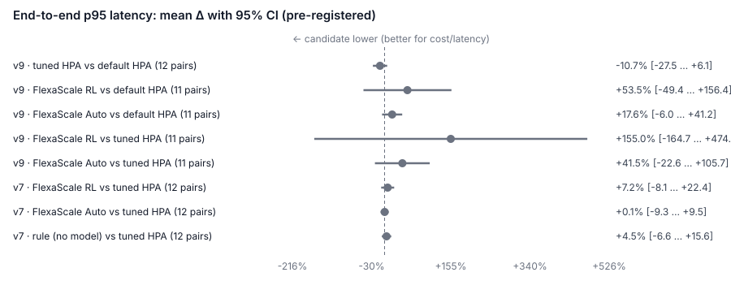

Per scenario, Auto vs default HPA (mean of the pairs; `data/v9_auto_vs_default_pairs.csv`):

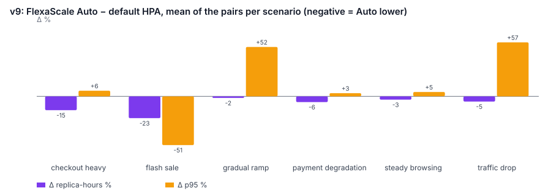

Flash sale and checkout-heavy carry the saving; gradual ramp and traffic drop show the latency cost (p95 +30–65%), which
is why the pooled p95 check fails.

---

## 5. Performance charts

Mean of every valid run per arm (v9, 11–12 runs each):

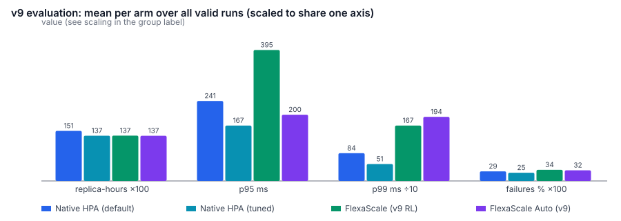

| Arm | Runs | Replica-h | Cost USD | p50 | p95 | p99 | Failures % | req/s |
|---|---:|---:|---:|---:|---:|---:|---:|---:|
| Default HPA | 12 | 1.512 | 0.00685 | 44 | 241 | 838 | 0.29 | 15.13 |
| Tuned HPA | 12 | 1.366 | 0.00618 | 42 | 167 | 510 | 0.25 | 15.37 |
| FlexaScale RL | 11 | 1.368 | 0.00619 | 37 | 395 | 1674 | 0.34 | 15.07 |
| FlexaScale Auto | 11 | 1.365 | 0.00618 | 37 | 200 | 1936 | 0.32 | 15.15 |

FlexaScale's median latency is the lowest (37 ms), its tail (p99) the highest: it keeps services lean, which is fast in
the common case and occasionally slow when a burst arrives before a scale-up.

---

## 6. Resource-efficiency analysis

* **Replica-hours** (Section 4) are the primary measure. FlexaScale's ~7–8% saving over default HPA comes from two
  behaviours visible in E1–E4: not scaling services whose CPU rises briefly (checkout heavy), and not keeping spike
  capacity for HPA's 5-minute scale-down window (flash sale).
* **CPU allocation efficiency** (used ÷ allocated CPU; `data/selected_runs.csv`, column `cpu_allocation_efficiency_pct`)
  is correspondingly higher for FlexaScale and tuned HPA (average CPU 32–40% of request vs 24–28% for default HPA in
  E1–E4): the same work is done on fewer replicas.
* At 25 users most services stay at their minimum under every good controller, which bounds any possible saving (the
  floor is 16 replicas × 0.083 h = 1.333 replica-hours; tuned HPA and FlexaScale are within 2–6% of it).

## 7. Cost analysis

Estimated cost follows replica-hours almost exactly (all services request the same 100m CPU / 128–256 MiB):
FlexaScale Auto vs default HPA **−7.9% [−12.5 … −3.2]**, RL **−7.4%**; vs tuned HPA **+0.2%** (Auto). Per 300-second run
this is about $0.0007 — tiny in absolute terms because the shop is small; the percentage is what would scale. The
prices are AWS Fargate on-demand list prices (us-east-1), an assumption, not a bill.

## 8. SLA analysis

* Whole-run p95 met the 1000 ms SLO in **every** selected run.
* Time in violation (10 s windows above 1000 ms): E1 default HPA 30 s vs Auto 0 s; E2 default HPA 115 s vs RL 30 s;
  checkout heavy 10–40 s for all controllers.
* Pooled (v9): mean SLO-violation time per run 22.9 s (default HPA), 8.0 s (tuned), 25.6 s (RL), 15.7 s (Auto). Auto is
  better than default HPA, worse than tuned HPA; RL is about the same as default HPA. The dashboard and these reports
  compute "SLA met/violated" from exactly the p95 they display.

---

## 9. End-to-end verification (this laptop, 2026-10-31)

The controller-mode verification is documented in `verification/README.md` with the evidence of each run (decision log,
lab events, kubectl snapshots). Summary:

| Scenario (flash sale, 40 users unless noted) | What was verified | Evidence |
|---|---|---|
| Native HPA, FlexaScale in shadow | HPA scaled order and catalog 1→3, api-gateway and inventory 1→2; FlexaScale logged 496 proposals, applied 0; Lease free | `20261031-001033-…-hpa-…` |
| FlexaScale v9 / v7 (40 users) and v7 (25 users) | Live mode, Lease taken, every service FlexaScale-owned, 512 decisions each, all accepted by safety — but **no scale change**: both policies held 1 replica (see below) | `…-001628-…`, `…-032758-…`, `…-040706-…` |
| **Auto, default policy** | **Auto selected FlexaScale (rule efficiency) for order-service, the v9 GNN+PPO policy proposed scale_up, safety accepted, the HPA was frozen, Kubernetes set desired 1→2 (+6 s) and 2 pods were ready (+16 s)** | `…-002805-…` |
| **Auto, controlled SLA-risk variant** | **Mixed ownership** in 21 of 31 steps (e.g. api-gateway, cart, catalog, inventory, order → HPA by `sla_risk` while 11 services stayed with FlexaScale); HPA scaled the risky services to 3; FlexaScale applied 7 actions (order-service 1→2 at +29 s, then scale-downs) | `…-035531-…` |
| Auto, Prometheus stopped 60 s | All 16 services → HPA in the same step (`controller_health`), every HPA unfrozen, HPA scaled meanwhile; FlexaScale retook ownership after 2 steps and applied 6 scale-downs | `…-030452-…` |
| Auto, operator SIGKILLed | Lab watchdog restored all 16 HPAs 1 s later; HPA scaled order 1→4, catalog 1→3 for the rest of the run | `…-031625-…` |
| Every run | Cleanup verified safe (no frozen HPA, no Lease held); no applied action without FlexaScale ownership and an HPA freeze | `verification/*.json` |

FlexaScale-mode scale changes were verified on the cluster before this session, e.g. `20261028-061846-shopping-flexascale-flash_sale`
(v7, this laptop, 25 users: order-service 1→2 at +115 s, ready at +130 s, back to 1 at +255 s) and E2 above (v9).

**An honest finding from these runs.** At 40 users order-service's latency rose ~10× while its CPU stayed at 30–50% of
its limit (it is limited by synchronous database calls, not CPU; `docs/POLICY_V8.md`). The learned policies read mainly
CPU relative to the limit, so in FlexaScale mode they held 1 replica while default HPA (70% of the *request* = 14% of
the limit) added replicas: end-to-end p95 was 2.0–2.4 s under FlexaScale vs 4.2 s under HPA with 3.4% failures, but
also up to 6 s in the Auto runs. In Auto mode the default SLA-risk threshold (CPU 400% of request, calibrated on the
second laptop) did not hand these services to HPA; with the controlled threshold (60%) it did. Per-laptop calibration
and an end-to-end latency input to Auto are the main improvements this points to.

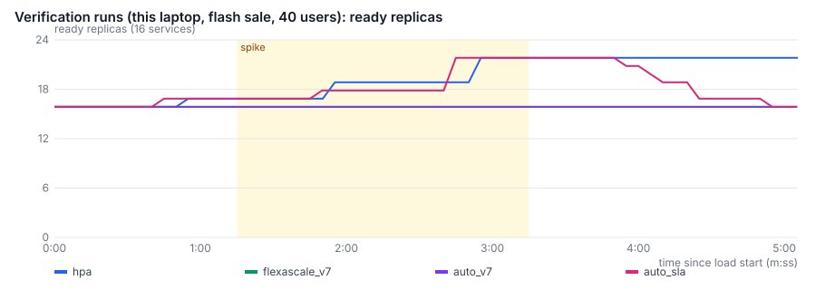

Full per-service tables (owner, rule, policy invoked, applied action with Kubernetes confirmation times, replicas) and
the fault-injection timelines: `verification/README.md`.

These runs use 40 users on this (first) laptop and are **demonstrations of correct behaviour, not benchmark pairs**
(they are labelled `verify-*`, which the dashboard's benchmark never pairs).

---

## 10. Screenshots

Taken from the running control center (`http://127.0.0.1:8090/`) on 2026-10-31.

| Screenshot | Shows |
|---|---|
| 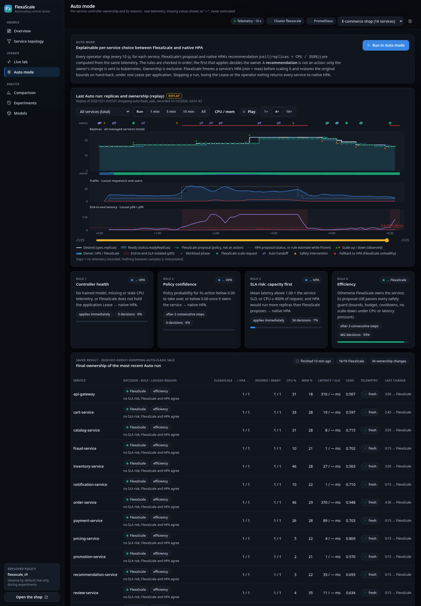 | **Auto mode page** after the SLA-risk run: replay with owner band, handoff and scale-request markers, rule usage (SLA risk 7%, efficiency 93%), per-service owners and reasons |
| 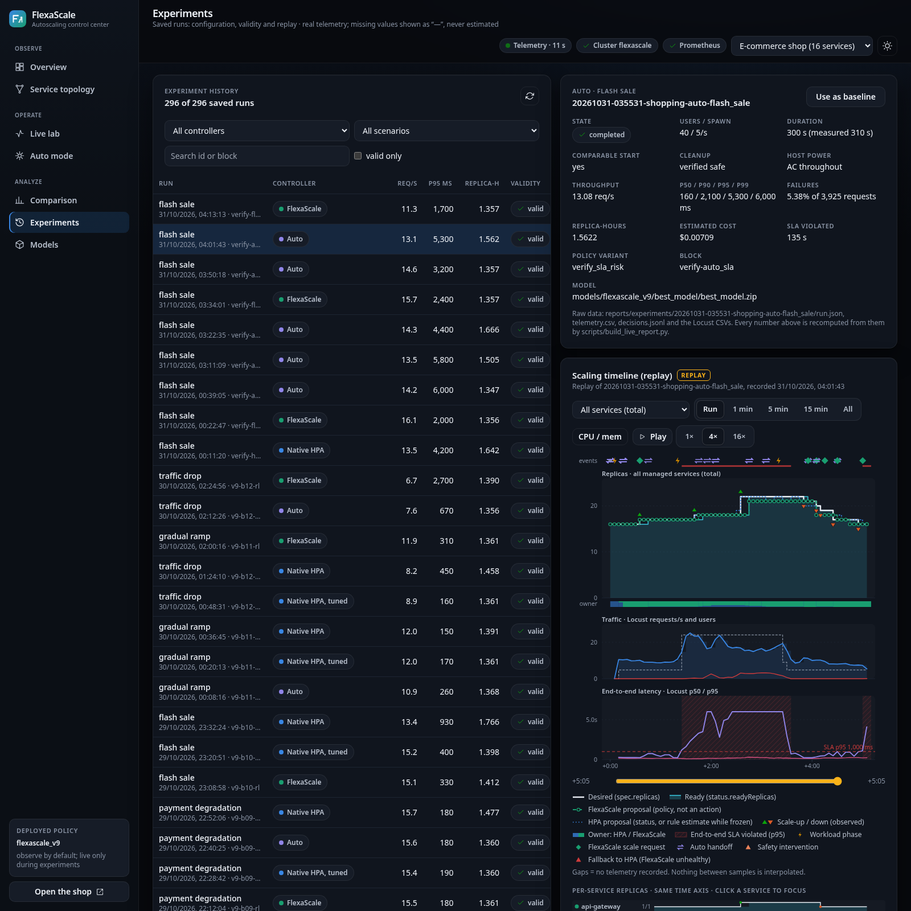 | **Experiments → replay** of the same run: desired/ready replicas, FlexaScale and HPA proposals, observed scale-ups/downs |
| 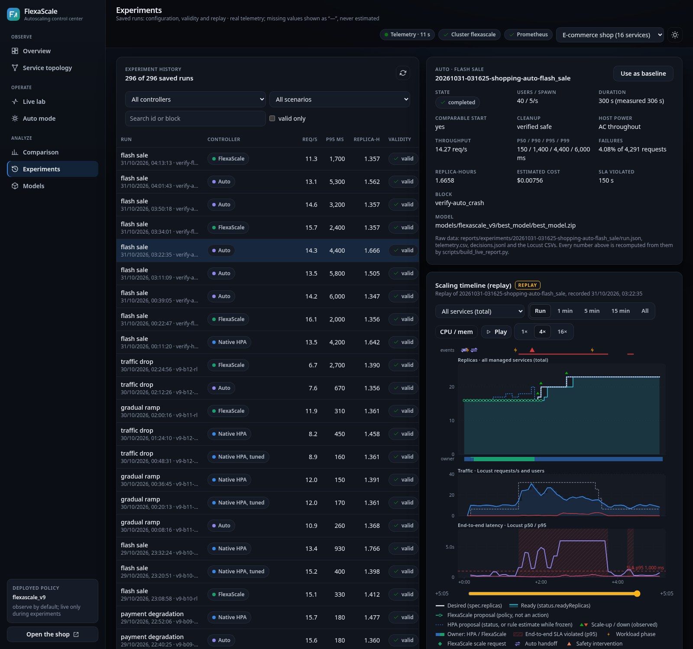 | Replay of the operator-kill run: the red fallback marker and HPA scaling afterwards |
| 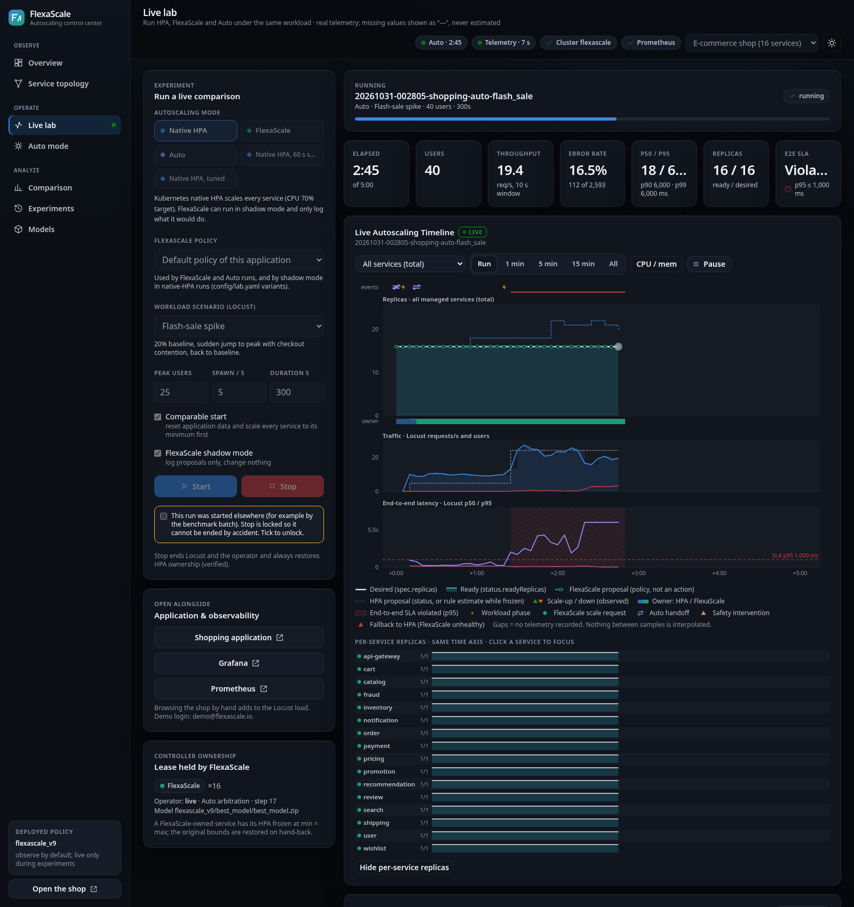 | **Live lab** during a running Auto experiment (live timeline, tiles, per-service strips) |
| 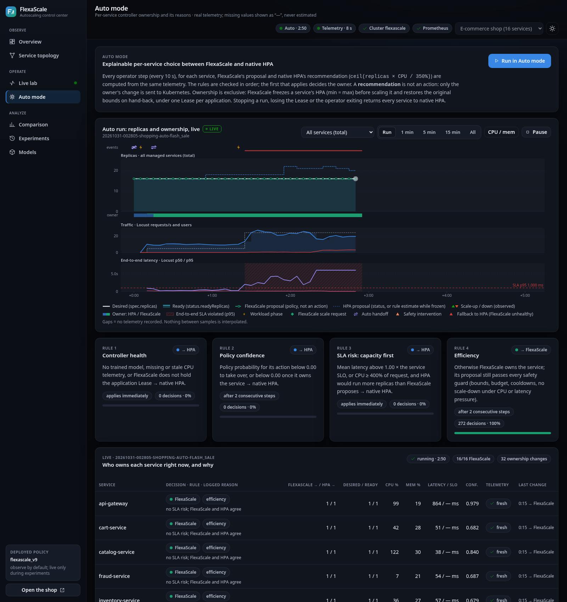 | **Auto mode page live**: every service's owner, rule, recommendation and telemetry |
| 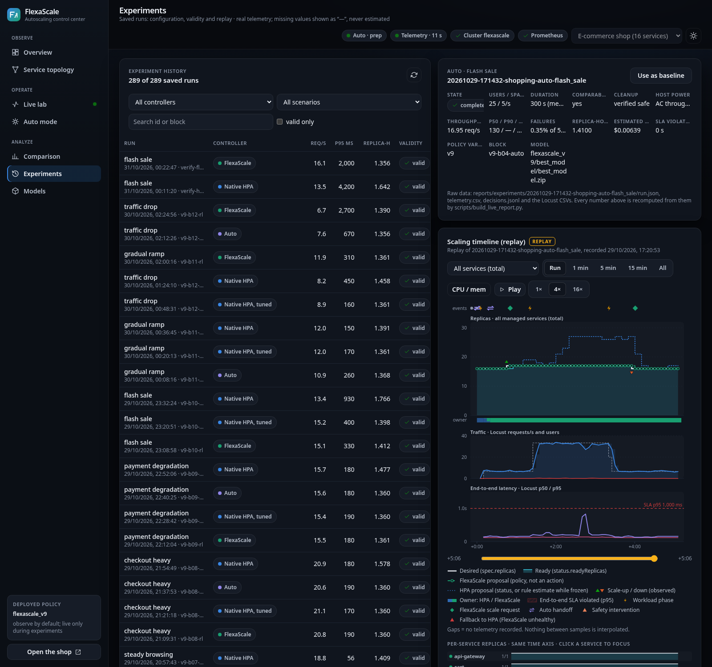 | **E1** (v9 Auto, flash sale, second laptop) replayed: configuration, validity, result and timeline |
| 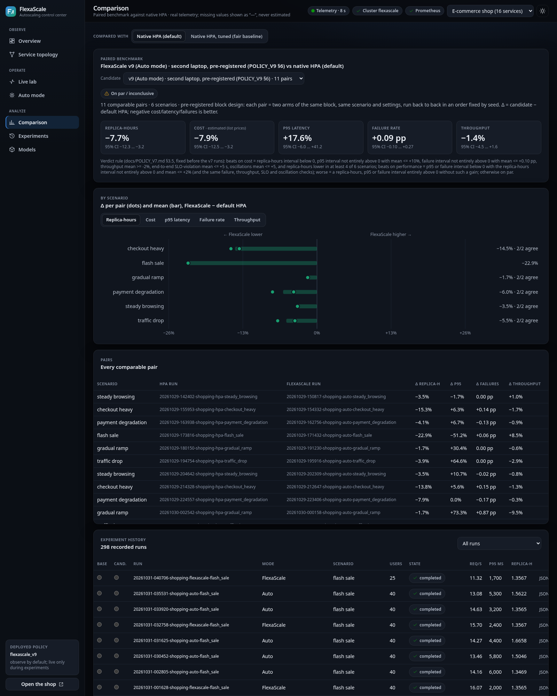 | **Comparison page**: v9 Auto vs default HPA, pooled verdict, by-scenario chart, every pair |
| 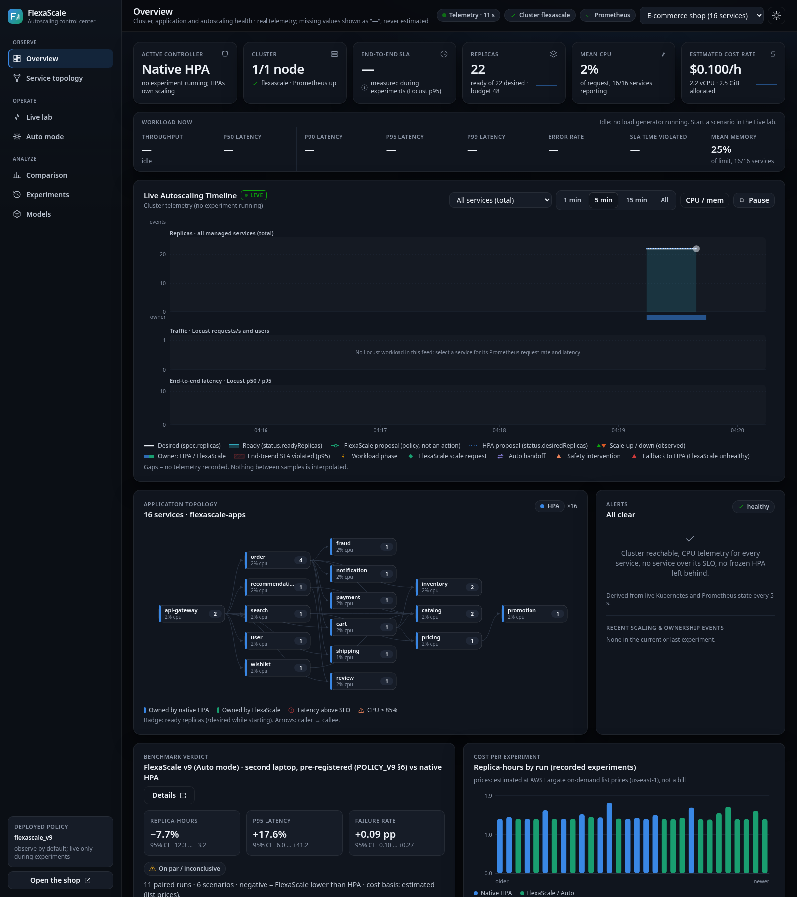 | **Overview** |
| 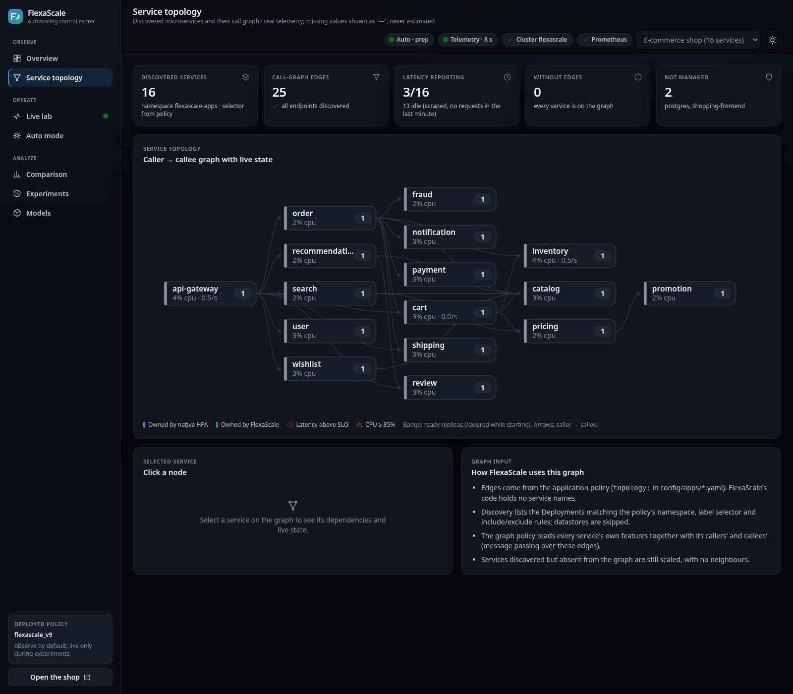 | **Service topology** (call graph used by the GNN) |
| 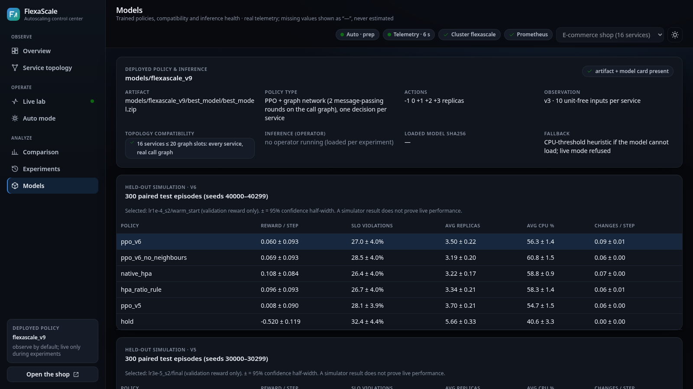 | **Models**: deployed v9 policy, compatibility, held-out simulation tables |

---

## 11. Limitations and conclusions

**Measurement conditions.** Single-node Minikube on a laptop (Windows 11 for v9, Fedora for v7 and the verification);
25 users for the evaluations; 300-second runs; one application (16 services) plus a 5-service bookstore for the Helm
tests. Host conditions were checked for every run (battery, CPU used outside Kubernetes); host-affected runs were
excluded and rerun once by a rule fixed in advance (`reports/experiments_invalid/README.md` lists every excluded run and
why). An earlier first-laptop batch that seemed to show Auto beating tuned HPA on p95 (−21.6%) was traced to a CPU
power-profile confound and withdrawn (`docs/V7_REPORT.md`); results from before that discovery (e.g. v6 Auto −3.9% vs
default HPA, 18 pairs) are reported only with that caveat.

**What is established.**

* FlexaScale controls a real application safely and explainably, per service, with verified hand-back to native HPA in
  every failure mode tested.
* It uses 7–8% fewer replica-hours than default HPA, with the largest savings in flash sales (−20 to −23% with lower
  p95 in the two flash-sale pairs) and checkout-heavy load (−14 to −15% at +6% p95).
* It is on par with a tuned HPA in two independent pre-registered evaluations.
* The graph input (GNN message passing) showed no measurable benefit in the ablation (`reports/v9/ablation.md`).

**What is not established.** That FlexaScale beats a well-tuned HPA; that the flash-sale advantage over default HPA holds
statistically (one pair per arm); that results transfer to larger clusters or heavier loads.

**Invalid experiments** are preserved separately in `reports/experiments_invalid/` (battery, host load, memory
pressure, lid-close incidents — each explained in its README) and demo/smoke runs in `reports/experiments_demo/`; none
is used above.
